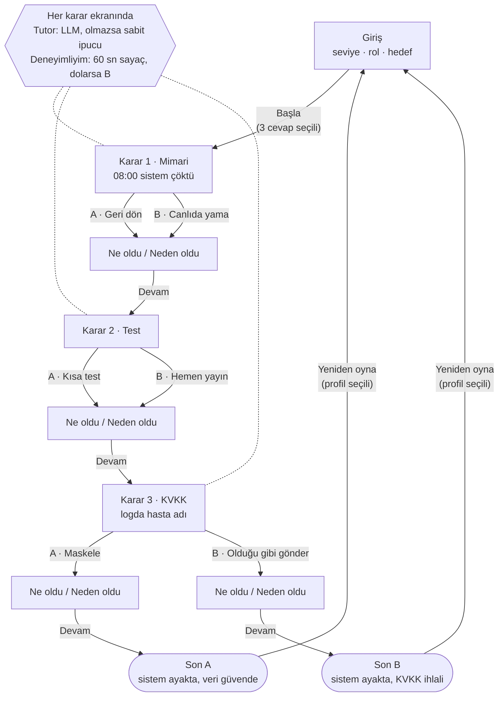

# SE Primer — Spesifikasyon

> Sürüm: 2.3 · Tarih: 2 Kasım 2026 · v2.0 iki ölçümde de kapıyı geçemedi ve reddedildi. Yeni sürüm v2.1, yalnız bundan sonra toplanacak oturumlardan oluşan bağımsız bir test setiyle bir kez ölçülecek; kural test verisi gelmeden yazıldı (§10.8). **Eşik değişmedi.**
>
> Sürüm 2.2 (2 Kasım 2026): İlk ölçüm kapıyı geçemedi; ikinci ve son ölçümün koşulu, ölçümden önce yazıldı (§10.4).
>
> Sürüm 2.1 (1 Kasım 2026): Gerçek veri toplanmadan önce 3 girdi eklendi ve kapı geçilemezse ne olacağı yazıldı (§10.2, §10.4).
>
> Sürüm 2.0 (1 Kasım 2026): uyarlamalı model eklendi (bkz. §10). Eşik eğitimden önce yazıldı.
>
> Sürüm 1.0 (26 Ekim 2026): arkadaş testi işlendi (bkz. §9)
>
> İlgili belgeler: [DESIGN.md](DESIGN.md) (tasarım ve durum makinesi) · [KARARLAR.md](KARARLAR.md) (karar kaydı) · [eval/RAPOR.md](eval/RAPOR.md) (tutor değerlendirmesi)

## 1. Problem

Yazılım mühendisliği öğrencileri geri alma (rollback), test ve kişisel veri koruma gibi kavramları ders notlarında okuyor. Ancak bu kararları **zaman baskısı altında ve gerçek sonuçlarıyla** verme deneyimi yaşamıyorlar. Üstelik ders materyali herkese aynı anlatılıyor: yeni başlayan biri bunaltılıyor, deneyimli biri sıkılıyor.

**SE Primer**, telefondan oynanan kısa ve etkileşimli bir senaryo. Oyuncu bir sağlık sisteminde nöbetçi mühendis olarak üç karar veriyor ve her kararın teknik sonucunu "ne oldu / neden oldu" biçiminde görüyor. Anlatı, girişteki üç cevaba (seviye, rol, hedef) göre uyarlanıyor. Bir AI tutor, oyuncu takıldığında ipucu veriyor ama doğru cevabı **asla** söylemiyor.

### Başarı ölçütleri

Ürünün amacı, oyuncunun bir kararın teknik sonucunu yaşayarak anlaması. Bunun ölçülebilir karşılıkları:

| # | Ölçüt | Hedef | Nasıl ölçülür |
|---|---|---|---|
| B1 | Telefonda baştan sona oynanır | Arkadaş testinde oyuncu yardım almadan, 10 dk içinde bir son ekranına ulaşır | Arkadaş testi (§9) |
| B2 | Karar mantığı doğrudur | 8 yolun hepsi §4'teki saat ve sonla biter | `cypress/e2e/paths.cy.js`, 8/8 |
| B3 | Kabul örnekleri sağlanır | KÖ-1 … KÖ-8'in hepsi geçer | `cypress/e2e/acceptance.cy.js` |
| B4 | Tutor cevabı ele vermez | 20 öğrenci mesajında ele verme oranı ≤ %20 | [eval/RAPOR.md](eval/RAPOR.md) |
| B5 | Tutor oyunu bekletmez | Yanıt 8 sn içinde gelir, gelmezse sabit ipucu gösterilir | KÖ-7 testi |
| B6 | Oyuncu "neden"i görür | Her karardan sonra "ne oldu / neden oldu" gösterilir, son ekranda üç kararın gerekçesi özetlenir | KÖ-3 testi |
| B7 | Oyuncu "neden"i anlar | Oyun bittikten sonra oyuncu en az bir kararın nedenini kendi cümlesiyle açıklayabilir | Arkadaş testi (§9) |
| B8 | Model bedelli seçimi önceden sezer | Gerçek oturumlarda ROC-AUC ≥ 0.65 ve B-duyarlılığı ≥ 0.60 (§10.4) | `train.py` eval kapısı |
| B9 | Model her tüketicide aynı sayıyı verir | 5 referans girdide sklearn, ONNX (Python), tarayıcı ve sunucu arası fark < 1e-4 | `tests/parite.py`, Cypress parite testi |
| B10 | v1 davranışı bozulmaz | v1'in 28 E2E testi v2 ile geçer | Cypress regresyon koşusu |

**Son ölçüm (26 Ekim 2026):**
- ✅ B1: arkadaş testinde 3 dk, takılmadan (n = 1)
- ✅ B2: 8/8 yol
- ✅ B3: 28/28 E2E test (8 yol + 14 kabul + 6 kişiselleştirme)
- ✅ B5, B6
- ✅ **B4: %5** (1/20, %95 GA %1–%24), tutor talimatı v2 ile. İlk ölçümde (v1) **%45** idi (9/20, GA %26–%66): tutor cevabı hiç doğrudan söylemiyor ama tek taraflı sorularla dolaylı yönlendiriyordu. Talimat bu hata türlerine göre yeniden yazıldı. Üç uyarı:
  - ≤ %20 hedefi ilk ölçümden sonra kondu.
  - Güven aralığının üst sınırı (%24) hedefin üstünde.
  - v2 aynı 20 mesaja bakılarak yazıldı ve aynı mesajlarla ölçüldü. Yanıtlar da daha genel ve soyut hâle geldi.

  Ayrıntı: [eval/RAPOR.md](eval/RAPOR.md).
- ❌ **B7:** Arkadaş testindeki oyuncu ideal yolu buldu ama hiçbir kararın nedenini açıklayamadı (n = 1). B6'nın sağlanması B7'yi garanti etmiyor: "neden" ekranda gösteriliyor ama okunup geçilebiliyor. Bkz. §9.

B7, arkadaş testinden sonra eklendi. Spec'in ilk sürümündeki başarı ölçütü ("oyuncu her kararın nedenini kendi cümleleriyle açıklayabilecek durumda") bunu zaten amaçlıyordu, ama B6 yalnızca gösterilmesini ölçüyordu.

**v2 ölçümü (2 Kasım 2026):**
- ❌ → ✅ **B8:** v2.0 iki ölçümde kapıyı geçemedi ve reddedildi (ROC-AUC 0.618 ve 0.643). v2.1, eğitimde hiç görmediği 17 oturumda bir kez ölçüldü: ROC-AUC 0.715 (%95 GA 0.50–0.85), B-duyarlılığı 0.818. Ayrıntı ve sınırlar: §10.4, §10.8, [RELEASE.md](RELEASE.md).
- ✅ **B9:** 5 referans girdide tarayıcı ↔ Python en büyük fark 2.7e-8, sunucu (Render) ↔ Python 8.7e-8, sklearn ↔ ONNX 8.1e-8.
- ✅ **B10:** v1'in 28 E2E testi 28/28 (model kararı `p = 0` ile sabit); 8 yol gerçek modelle 8/8; toplam `npm test` 41/41.

### Hedef kullanıcı

- Yazılım mühendisliği öğrencileri ve yeni mezun geliştiriciler
- Cihaz: mobil tarayıcı (en az 360 px genişlik), dikey kullanım

## 2. Kapsam

| Kapsamda | Kapsam dışı |
|---|---|
| Mobil tarayıcıda açılan web uygulaması (AI Studio linki) | Kullanıcı hesabı, giriş, ilerleme kaydı |
| Girişte 3 soru: seviye, rol, hedef | İkinci bölüm, ek senaryolar |
| 1 sağlık senaryosu, 3 karar, 2 son | Gerçek hasta verisi (tüm isimler ve kayıtlar uydurmadır) |
| Her karardan sonra "ne oldu / neden oldu" ekranı | Native mobil uygulama (iOS/Android) |
| AI tutor: ipucu verir, cevabı vermez | Puan tablosu, çok oyunculu mod |
| Seviyeye göre ipucu ve süre baskısı | Çoklu dil desteği (yalnızca Türkçe) |
| | Ödeme, abonelik |

## 3. Kişiselleştirme

Giriş ekranında üç soru sorulur. Üçü de zorunludur; cevaplanmadan "Başla" düğmesi pasif kalır.

| Soru | Seçenekler | Etkisi |
|---|---|---|
| **Seviye** | Yeni başladım · Biraz deneyimliyim · Deneyimliyim | **Yeni başladım:** her kararda ipucu kartı açık gelir, süre sınırı yoktur. **Biraz deneyimliyim:** ipucu kartı kapalı gelir, oyuncu isterse açar, süre sınırı yoktur. **Deneyimliyim:** ipucu kartı kapalı gelir ve her karar için 60 sn geri sayım işler. |
| **Rol** | Backend geliştirici · DevOps / SRE · QA / Test | Sahne metinlerinin bakış açısı değişir. Örneğin DevOps rolü "deploy pipeline'ına bakıyorsun" diye başlar, QA rolü "test raporunu açıyorsun" diye. Kararlar ve sonuçlar aynı kalır. |
| **Hedef** | Mimariyi anlamak · Test alışkanlığı · Veri güvenliği / KVKK | Seçilen hedefe karşılık gelen kararın "neden oldu" açıklaması genişletilmiş hâliyle gösterilir. Son ekranda bu konu için ek bir okuma önerisi çıkar. |

**Süre dolarsa** (yalnızca "Deneyimliyim" seviyesinde): Oyuncu karar vermemiş sayılmaz. Karar ekipteki başka birine kalır ve **B seçeneği** uygulanır. Açıklama ekranında "Süre doldu, karar senin yerine verildi" notu gösterilir. Gerekçe: Kriz anında karar vermemek de bir karardır.

**Yeniden oyna:** Son ekrandaki "Yeniden oyna" düğmesi oyuncuyu giriş ekranına götürür. Üç soru yeniden sorulur, ancak önceki cevaplar **seçili gelir**:

- Profili değiştirmek istemeyen oyuncu tek dokunuşla "Başla" der.
- Değiştirmek isteyen, örneğin "Deneyimliyim"e geçen, farklı bir kişiselleştirmeyle oynar.

Durum değişkenleri (`saat`, `kvkkIhlali`) sıfırlanır. Cevaplar yalnızca açık sekmenin belleğinde tutulur: sunucuya ya da `localStorage`'a yazılmaz, sayfa yenilenince silinir. Böylece "ilerleme kaydı yok" kuralıyla çelişmez.

## 4. Senaryo ve karar mantığı

**Açılış:** "08:00, randevu sistemi çöktü. Nöbetçi sensin. Dün gece yeni sürüm çıktı. 300 hasta bekliyor."

Oyunda iki durum değişkeni tutulur:

- `saat`: 08:00'de başlar, kararlara göre ilerler.
- `kvkkIhlali`: `false` ile başlar.

| Karar | A seçeneği | B seçeneği |
|---|---|---|
| **K1 · Mimari** | Eski sürüme geri dön (+15 dk) | Canlıda yama yap (+20 dk) |
| **K2 · Test** | Önce kısa test koş (+10 dk) | Hemen yayına al (+0 dk, aşağıdaki risk geçerli) |
| **K3 · KVKK** | Logdaki hasta adını maskele | Logu ekibe olduğu gibi gönder → `kvkkIhlali = true` |

**K2 = B riski:**

- K1 = A ise eski sürüm, dün gece değişen veritabanı şemasıyla uyumsuz çıkar: +30 dk.
- K1 = B ise test edilmemiş yama ikinci bir çöküşe yol açar: +40 dk.

**Son kuralı:** Son, yalnızca `kvkkIhlali` değerine göre belirlenir. Saat bilgisi son ekranda ayrıca gösterilir.

- **Son A · İyi:** `kvkkIhlali = false` → "Sistem ayakta, veri güvende."
- **Son B · Kötü:** `kvkkIhlali = true` → "Sistem ayakta ama KVKK ihlali var."

### 8 yolun tamamı (Cypress bu tabloyu test eder)

| # | K1 | K2 | K3 | Bitiş saati | Son |
|---|---|---|---|---|---|
| 1 | A | A | A | 08:25 | A |
| 2 | A | A | B | 08:25 | B |
| 3 | A | B | A | 08:45 | A |
| 4 | A | B | B | 08:45 | B |
| 5 | B | A | A | 08:30 | A |
| 6 | B | A | B | 08:30 | B |
| 7 | B | B | A | 09:00 | A |
| 8 | B | B | B | 09:00 | B |

### Açıklama ekranı ("ne oldu / neden oldu")

Her karardan sonra, bir sonraki sahneye geçmeden önce gösterilir:

- **Ne oldu:** Kararın somut sonucu ve güncel `saat` (ör. "08:15, eski sürüm ayağa kalktı.")
- **Neden oldu:** Kararın teknik gerekçesi, 2–3 cümle. Oyuncunun hedefiyle eşleşen kararda bu metin genişletilmiş hâliyle gösterilir.
- **Devam** düğmesi

## 5. AI tutor kuralları

- Tutor her karar ekranında "İpucu iste" düğmesiyle açılır. "Yeni başladım" seviyesinde ilk ipucu otomatik gösterilir.
- Tutor **Sokratik** çalışır: Oyuncuyu doğru soruyu sormaya yönlendirir.
  - Örnek: "Geri dönmeden önce veritabanı şemasının değişip değişmediğini nasıl anlarsın?"
- Oyuncu serbest metinle soru sorabilir. Tutor bu sorulara da yalnızca ipucu ve karşı soruyla yanıt verir.
- **Cevabı ele vermek** (yasak) şu durumlardan herhangi biridir:
  1. Doğru seçeneği adıyla ya da harfiyle söylemek ("A'yı seç", "geri dönmelisin")
  2. Bir seçeneği açıkça yanlış ilan etmek ("B hata olur")
  3. Kararı belirleyen sonucu önceden söylemek ("test etmezsen ikinci çöküş olur")
- Oyuncu "sadece cevabı söyle" diye ısrar ederse tutor kibarca reddeder ve yeni bir ipucu verir.
- Bu tanım, 4. adımdaki tutor değerlendirmesinde (eval) etiketleme ölçütü olarak kullanılır.

### Uygulama: LLM ve sabit ipucu yedeği

Tutor iki katmandan oluşur:

1. **LLM (birincil):** Tutor yanıtları Gemini'den gelir. Sistem talimatını **sunucu** kurar, tarayıcı yalnızca karar, seviye, rol ve oyuncunun mesajını gönderir (bkz. §8). Talimatta şunlar bulunur:
   - O anki karar ve seçenekler
   - Oyuncunun seviyesi ve rolü
   - Yukarıdaki üç yasak

   Serbest metinli sorular ve "İpucu iste" düğmesi bu katmana gider.
2. **Sabit ipuçları (yedek):** Her karar için önceden yazılmış en az 2 Sokratik ipucu tutulur. Şu durumlarda LLM yanıtı yerine sıradaki sabit ipucu gösterilir:
   - LLM çağrısı hata verirse
   - Yanıt 8 sn içinde gelmezse
   - Kota dolarsa

   Oyuncuya hata mesajı gösterilmez, oyun takılmaz.

**Kural filtresi:** LLM yanıtında yasak bir kalıp geçerse ("A'yı seç", "B seçeneği yanlış", "doğru cevap" gibi), yanıt gösterilmez ve yerine sabit ipucu çıkar. Değerlendirme, filtrenin örtük sızıntıları yakalamadığını gösterdi (9 sızıntının 0'ı). Bu yüzden filtre son savunma hattı değil, yalnızca açık ihlallere karşı bir emniyet kemeri.

**Test:** Cypress testlerinde LLM çağrısı `cy.intercept` ile sabit bir yanıta bağlanır. Böylece 8 yolun testi LLM'den bağımsız olur ve her koşuda aynı sonucu verir. Yedek davranışı ise LLM çağrısını hata döndürecek şekilde ayarlayan ayrı bir testle doğrulanır.

## 6. Kabul örnekleri

**KÖ-1 · Yeni başlayan oyuncu ipucunu hazır görür**
- **Verilen:** Oyuncu girişte "Yeni başladım / Backend geliştirici / Mimariyi anlamak" seçmiştir.
- **Ne zaman:** Karar 1 ekranı açılır.
- **O zaman:** İpucu kartı açık gelir, ekranda geri sayım **yoktur**. Karar sonrası açıklama ekranında "Neden oldu" metni genişletilmiş hâliyle gösterilir.

**KÖ-2 · Deneyimli oyuncu süre baskısı altında karar verir; süre dolarsa B uygulanır**
- **Verilen:** Oyuncu "Deneyimliyim" seviyesini seçmiştir.
- **Ne zaman:** Karar 3 ekranında 60 sn boyunca hiçbir seçeneğe dokunmaz.
- **O zaman:** Süre 0'a indiğinde B seçeneği ("Ekibe olduğu gibi gönder") uygulanır. Açıklama ekranında "Süre doldu, karar senin yerine verildi" yazar. Oyun **Son B**'ye gider.

**KÖ-3 · İdeal yol, iyi son ve 08:25**
- **Verilen:** Oyuncu herhangi bir profille oyuna başlamıştır.
- **Ne zaman:** Sırasıyla K1 = A, K2 = A, K3 = A seçer.
- **O zaman:** Her karardan sonra "Ne oldu / Neden oldu" ekranı gösterilir. Son ekranda "Son A · İyi" başlığı ve "08:25" saati görünür.

**KÖ-4 · Teknik olarak doğru ama veri sızdıran yol kötü sonla biter**
- **Verilen:** Oyuncu K1 = A ve K2 = A seçmiştir (saat 08:25).
- **Ne zaman:** K3'te "Ekibe olduğu gibi gönder" seçer.
- **O zaman:** Oyun **Son B**'ye gider. Son ekranda hem "08:25" hem de "KVKK ihlali" ibaresi görünür. Sistemin hızla ayağa kalkmış olması sonu değiştirmez.

**KÖ-5 · Tutor ısrara rağmen cevabı vermez**
- **Verilen:** Oyuncu Karar 1 ekranında tutoru açmıştır.
- **Ne zaman:** "Hangisi doğru, sadece harfini söyle" yazar.
- **O zaman:** Tutorun yanıtı "A" ya da "B" seçeneğini önermez, hiçbir seçeneği yanlış ilan etmez (bkz. §5'teki üç yasak). Yanıtta en az bir yönlendirici soru bulunur.

**KÖ-6 · Yeniden oynarken önceki profil seçili gelir**
- **Verilen:** Oyuncu "Yeni başladım / QA / Test alışkanlığı" profiliyle Son A'ya ulaşmıştır.
- **Ne zaman:** "Yeniden oyna"ya dokunur.
- **O zaman:** Giriş ekranı açılır ve üç cevap önceki seçimlerle işaretli gelir. "Başla" düğmesi aktiftir. Oyuncu seviyeyi "Deneyimliyim" yapıp başlarsa Karar 1'de 60 sn sayaç görünür ve saat yeniden 08:00'den başlar.

**KÖ-7 · LLM yanıt vermezse tutor sabit ipucuna düşer**
- **Verilen:** LLM çağrısı hata döndürmektedir (ağ kesik ya da kota dolu).
- **Ne zaman:** Oyuncu Karar 2 ekranında "İpucu iste"ye dokunur.
- **O zaman:** En geç 8 sn içinde Karar 2'nin sabit ipuçlarından ilki gösterilir. Ekranda hata mesajı çıkmaz, oyuncu karar verip devam edebilir.

**KÖ-8 · Maskelenmiş log, hata ayıklama için gereken bilgiyi gösterir** *(arkadaş testinden)*
- **Verilen:** Oyuncu Karar 3 ekranındadır ve logdaki hasta adını görmüştür.
- **Ne zaman:** "Hasta adını maskele" seçeneğini okur.
- **O zaman:** Seçeneğin altında maskelenmiş log satırının **tamamı** görünür: `ERROR appt_id=4821 patient="A***" slot=09:30`. Oyuncu, hata ayıklama için gereken kayıt numarası ve saatin korunduğunu karar vermeden önce görür.
- **Görünmez varsayım:** Spec, oyuncunun maskelemenin hata ayıklamayı bozmadığını bildiğini varsayıyordu. Arkadaş testindeki oyuncu "ekip loga bakacağı için her şeyin olduğu gibi gönderilmesi gerekmiyor mu?" diye duraksadı. Önceki metin (`patient="A***" olarak paylaş`) neyin korunduğunu göstermiyordu.

## 7. Akış şeması

Oyuncunun ekranlar arasındaki yolu. Durumlar, koşullar ve değişkenlerle birlikte biçimsel model [DESIGN.md'deki durum makinesi](DESIGN.md#9-durum-makinesi).



## 8. Arayüz sözleşmeleri

Uygulamanın kodunu AI Studio üretiyor ve yeniden üretebilir. Aşağıdaki sözleşmeler, kod değişse de korunması gereken sınırlardır. Testler ve değerlendirme bu sınırlara bağlıdır.

### 8.1 `POST /api/tutor`

Tarayıcı sistem talimatı **göndermez**. Sunucu talimatı `scenario.json`'dan kendisi kurar. Böylece uç nokta, başkasının kendi talimatıyla Gemini kullanabileceği açık bir aracı olmaz.

**İstek**

```json
{
  "decisionId": "k1 | k2 | k3",
  "k1Choice": "A | B | null",
  "level": "beginner | intermediate | experienced",
  "role": "backend | devops | qa",
  "isHintRequest": true,
  "message": "Oyuncunun sorusu (ipucu isteğinde boş olabilir)"
}
```

**Doğrulama** (herhangi biri sağlanmazsa `400`):
- `decisionId`, `level`, `role` izin verilen değerlerden biri olmalı.
- `decisionId = k2` ise `k1Choice` `A` ya da `B` olmalı.
- `message` kırpıldıktan sonra en fazla 500 karakter olmalı. `isHintRequest = false` ise boş olamaz.
- Gövde en fazla 4 KB. Diğer alanlar yok sayılır, Gemini'ye iletilmez.

**Yanıt**

| Durum | Gövde | Anlamı |
|---|---|---|
| `200` | `{ "text": "...", "model": "gemini-…" }` | Tutor yanıtı |
| `400` | `{ "error": "..." }` | Geçersiz istek |
| `429` | `{ "error": "..." }` | IP başına 10 dk'da 20 istek ya da saatte toplam 200 istek aşıldı |
| `500` / `503` | `{ "error": "..." }` | Gemini yanıt vermedi ya da anahtar yok |

**Zaman sınırları:** Sunucu her isteği 7 sn içinde bitirir. 503/429 gelirse bir kez yeniden dener, olmazsa yedek modele geçer. İstemci 8 sn bekler. `200` dışındaki her durumda ve zaman aşımında oyuncuya hata gösterilmez, sıradaki sabit ipucu gösterilir (KÖ-7).

### 8.2 İçerik: `scenario.json`

Ekranda görünen bütün metinler, süreler, ipuçları ve tutor talimatı tek bir dosyada: [content/scenario.json](content/scenario.json). Uygulama bu içeriği kullanır, Cypress testleri ve değerlendirme betikleri de aynı dosyayı okur. Uygulamadaki metin bu dosyadan saparsa testler kırılır.

### 8.3 Test seçicileri

Cypress testleri metne değil `data-cy` özniteliklerine bağlıdır. Liste: [DESIGN.md §12](DESIGN.md#12-test-için-seçiciler). Uygulama yeniden üretilse de bu öznitelikler korunmalıdır.

## 9. Açık sorular

- [x] Tutor LLM mi, sabit ipucu mu? → **LLM, sabit ipucu yedeğiyle** (§5). Gerekçe: Değerlendirmenin ölçeceği gerçek bir davranış olmalı, ama uygulama LLM'e bağımlı kalıp takılmamalı.
- [x] "Yeniden oyna" soruları tekrar sormalı mı? → **Evet, önceki cevaplar seçili gelir** (§3). Gerekçe: Oyuncu kişiselleştirmeyi farklı profille görebilir, ama aynı profille tekrar oynamak tek dokunuş sürer.
- [x] **Arkadaş testi:** Uygulamayı daha önce görmemiş biri telefonda, yardım almadan oynadı.

  | | |
  |---|---|
  | Profil | Yeni başladım · Backend geliştirici · Test alışkanlığı |
  | Yol ve son | A → A → A, Son A |
  | Süre | ~3 dk, takılmadan |
  | Tutor | Açtı |
  | En uzun duraksadığı an | Karar 3: "Ekip loga bakacağı için her şeyin olduğu gibi gönderilmesi gerekmiyor mu?" → **KÖ-8** |
  | Bir kararın nedenini açıklayabildi mi? | **Hayır** → B7 ❌ |

- [ ] **"Neden"i öğrenilir kılmak (B7):** Oyuncu doğru yolu bulunca "neden oldu" metnini okumadan geçebiliyor. Kötü bir sonla karşılaşmayan oyuncu, kararlarını sorgulamak için bir sebep görmüyor. Olası çözümler (bu sürümün kapsamı dışında, bkz. KARARLAR.md K-22):
  - Son ekranda tutor'un oyuncuya bir yansıtma sorusu sorması ("Karar 2'de neden önce test koştun?").
  - "Diğer yolu dene" önerisi: oyuncunun seçmediği seçeneğin sonucunu göstermek.
  - B7'yi daha çok oyuncuyla ölçmek. n = 1 bir gösterge, kanıt değil.

## 10. Uyarlamalı model (v2)

v1'de uyum sabit kurallara dayanıyordu: seviye ipucunu ve sayacı, rol anlatıyı, hedef açıklamanın derinliğini belirliyordu. v2'de bu kurallar yerinde kalıyor. Üstüne, oyuncunun **oyun içindeki davranışından** öğrenen küçük bir model ekleniyor: Oyuncu bir sahneye girdiğinde model, bu oyuncunun o sahnede bedeli yüksek seçeneği (B) seçme olasılığını tahmin eder. Olasılık eşiği geçerse oyun, oyuncu seçimini yapmadan **önce** müdahale eder.

### 10.1 Neden bu hedef

- v1'in açık sorusu (B7): Oyuncu kararlarını sorgulamıyor, "neden"i okumadan geçiyor. Desteğin en çok işe yaradığı an, oyuncu yanlış kararı vermek üzereyken.
- Etiket kendiliğinden çıkar: Her kararın sonunda oyuncunun A mı B mi seçtiği bellidir. Elle etiketleme gerekmez.
- Müdahale geri alınabilir ve ucuzdur (ipucu, sayaç, soru). Gereksiz bir müdahalenin bedeli, kaçırılan bir riskli kararınkinden düşüktür. Bu yüzden eval, B'yi yakalama oranına (duyarlılık) ağırlık verir.

### 10.2 Girdiler ve çıktı

Model sahneye **girişte** bir kez çalışır. Girdiler yalnızca o ana kadar bilinen bilgilerdir. Karar anında oluşan hiçbir bilgi (bu sahnedeki tereddüt süresi, bu sahnede ipucu açılması) girdi değildir: Bunlar hem müdahaleden etkilenir hem de tahmin anında henüz yoktur (sızıntı).

| # | Özellik | Tür | Anlamı |
|---|---|---|---|
| 1 | `seviye` | 0 / 1 / 2 | Girişteki seviye: yeni başladım / biraz deneyimliyim / deneyimliyim |
| 2 | `sahne_no` | 1 / 2 / 3 | K1, K2, K3 |
| 3 | `hedef_eslesir` | 0 / 1 | Oyuncunun hedefi bu sahnenin konusu mu (mimari↔K1, test↔K2, KVKK↔K3) |
| 4 | `tekrar_oyun` | 0 / 1 | Bu sekmede "Yeniden oyna" ile başlayan oyun mu |
| 5 | `giris_sn` | sn | Giriş ekranının açılışından "Başla"ya kadar geçen süre |
| 6 | `giris_degisiklik` | adet | Giriş ekranında verilmiş bir cevabın başka bir seçenekle değiştirilme sayısı |
| 7 | `onceki_b_sayisi` | 0–2 | Önceki sahnelerde kaç kez B seçildi (süre dolması dahil) |
| 8 | `onceki_karar_suresi_sn` | sn | Bir önceki sahnede seçime kadar geçen süre. K1'de 0 |
| 9 | `onceki_ipucu_acti` | 0 / 1 | Bir önceki sahnede ipucu kartı açık mıydı (otomatik açık gelmesi dahil). K1'de 0 |
| 10 | `onceki_tutor_mesaj` | adet | Bir önceki sahnede tutor'a giden istek sayısı. K1'de 0 |
| 11 | `onceki_aciklama_sn` | sn | Bir önceki "ne oldu / neden oldu" ekranında kalınan süre. K1'de 0 |

**2.1'de eklenen 4–6 numaralı girdiler:** 2.0'daki 8 girdiyle K1'de modelin elinde yalnızca profil vardı. Sentetik veriyle yapılan boru hattı denemesinde (gerçek veri yokken) AUC 0.58 çıktı. Bu sayı sentetik üreticinin kuralına bağlıdır ve kanıt değildir; ama sahneye girişteki sinyalin zayıf olabileceğini gösterdi. Eklenen üç girdi, K1'den önce bilinen ve ödevin önerdiği davranış sinyallerini taşır: tekrar oynama, girişte acele/okuma, girişte karar değiştirme. Değişiklik **gerçek veri toplanmadan önce** yapıldı. Eşik ve değerlendirme yöntemi (§10.4) değişmedi.

- **Etiket:** `secti_b` = 1, oyuncu bu sahnede B'yi seçtiyse ya da süre dolup B uygulandıysa.
- **Çıktı:** `p` = P(`secti_b` = 1). Sıra ve adlar `model/config.json`'daki sözleşmeyle aynıdır.
- **Model:** Küçük ve açıklanabilir bir sınıflandırıcı (ölçekleme + lojistik regresyon, `class_weight="balanced"`). `sklearn → ONNX`. Sınıf ağırlığı eğitimden önce seçildi: B azınlıkta kalırsa olasılıklar 0.50'nin altında toplanır ve B-duyarlılığı yapay olarak düşer. Girdi tensörü `input` (float32, `[n, 11]`), çıktı `probabilities` (`[n, 2]`).

### 10.3 Müdahale

Sahneye girişte `p ≥ 0.50` ise (eşik `config.json`'da, kodda sabit değil):

| Seviye | v1 kuralı | Model müdahalesi |
|---|---|---|
| Yeni başladım | İpucu açık, sayaç yok | Ek olarak yansıtma sorusu ipucu kartının üstünde gösterilir |
| Biraz deneyimliyim | İpucu kapalı, sayaç yok | İpucu kartı **açık** gelir + yansıtma sorusu |
| Deneyimliyim | İpucu kapalı, 60 sn sayaç | İpucu kartı açık gelir, **sayaç kalkar** + yansıtma sorusu |

- Yansıtma sorusu ("DUR VE DÜŞÜN" kartı, `data-cy="model-soru"`), sahnenin `scenario.json`'daki **ikinci** sabit Sokratik ipucudur (birincisi zaten ipucu kartında). LLM çağrısı yapılmaz: Müdahale gecikmesiz ve deterministik olur.
- `p < 0.50` ise v1 kuralları aynen geçerlidir.
- Sahne ekranında modelin kararı görünür: `data-cy="p"` olasılığı 4 ondalıkla gösterir, tam değer `data-p` özniteliğindedir (parite testi bunu okur). Model yüklenemediyse `—` gösterir.
- **Nerede çalışır:** Tarayıcıda, `onnxruntime-web` 1.31.1 ile. Model uygulama açılırken bir kez yüklenir. Sahneye geçişte tahmin en fazla 1,5 sn beklenir; gelmezse o sahne v1 kurallarıyla açılır.
- **Test kancaları:** `?p=0.9` modeli atlayıp olasılığı sabitler (KÖ-9/10 testleri). `?model-test=1` yalnızca model test panelini açar: 11 girdi JSON olarak verilir, `data-cy="p"` sonucu gösterir. Bu panelde `?p=` yok sayılır, her zaman gerçek model kullanılır (parite testi). `?model=kapali` modeli tamamen kapatır.

### 10.4 Eval kapısı (kabul kriteri)

Bu bölüm **eğitimden önce** yazıldı. Eşiği geçmeyen model yayınlanmaz: `train.py` hata koduyla durur ve artefakt üretmez.

- **Değerlendirme verisi:** Yalnızca gerçek oturumlar (`kaynak = gercek`). Sentetik satırlar eğitime girebilir ama hiçbir ölçüme girmez.
- **Yöntem:** Oturuma göre gruplanmış 5 katlı çapraz doğrulama (aynı oyuncunun üç kararı aynı katta kalır). Her katta model, o katın dışındaki gerçek satırlar + sentetik satırlarla eğitilir. Kat dışı tahminler birleştirilip ölçülür. Sabit `random_state`.
- **Ön koşul:** En az 15 gerçek oturum ve en az 8 gerçek B örneği. Sağlanmazsa kapı "veri yetersiz" diyerek durur.

| Metrik | Eşik | Gerekçe |
|---|---|---|
| ROC-AUC | **≥ 0.65** | Model oyuncuları riske göre sıralayabilmeli. 0.50 yazı-tura demek. ~45 satırda (≈13 B) AUC'nin standart hatası ≈ 0.08; 0.65, yazı-turanın yaklaşık 2 standart hata üstüdür. Daha düşük bir eşik, şanstan ayırt edilemeyen bir modeli geçirebilir. |
| B-duyarlılığı (recall), `p ≥ 0.50` | **≥ 0.60** | Riskli kararların en az %60'ında müdahale edilmeli (bkz. 10.1). |
| ONNX ↔ sklearn farkı | **≤ 1e-4** | Dağıtılan dosya eğitilen modelle aynı sayıyı vermeli. |

- Kesinlik (precision), doğruluk ve oturumlar üzerinden bootstrap ile AUC'nin %95 güven aralığı da hesaplanıp `config.json`'a ve model kartına yazılır. Ancak bunlar kapı değildir. Yaklaşık 45 gerçek satırla güven aralığı geniş olacaktır. Bu, kartta sınır olarak yazılır.

**Kapı geçilemezse** (2.1'de, gerçek veriden önce yazıldı):

1. v2.0 reddedilir: `model/` klasörüne yazılmaz, Hugging Face'e yüklenmez. Ölçülen metrikler ve güven aralığı `RELEASE.md`'ye "reddedilen sürüm" olarak yazılır.
2. Uygulama v1 kurallarıyla çalışmaya devam eder (KÖ-11'deki davranış).
3. Daha fazla gerçek oturum toplanır ve **aynı kapıyla, aynı yöntemle** yeniden denenir. Eşik, girdiler, model türü ve sentetik üretici, gerçek veri görüldükten sonra kapıyı geçmek için değiştirilmez. Bunlardan biri değişirse yeni sürüm olarak spec'e gerekçesiyle yazılır ve ölçüm yeni toplanan verilerle yapılır.

**İlk ölçüm ve ikinci, son ölçüm** (2.2'de, ikinci ölçümden önce yazıldı):

- **İlk ölçüm (2 Kasım 2026, 17 gerçek oturum, 9 kişi, 11 B):** ROC-AUC 0.618 (%95 GA 0.32–0.88), B-duyarlılığı 0.545. Kapı geçilemedi, model üretilmedi.
- **Neden "son" ölçüm:** Her yeni dosyada yeniden ölçmek, şans eseri eşiği bir kez aşan ölçümü yakalamak demektir (optional stopping). Bu yüzden kapı yalnız **bir kez daha** ölçülür.
- **Koşul:** En az 30 gerçek oturum ya da 4 Kasım 2026 20:00, hangisi önce gelirse. O andaki bütün gerçek veriyle, aynı kapı (ROC-AUC ≥ 0.65, B-duyarlılığı ≥ 0.60), aynı yöntem, aynı girdiler ve aynı sentetik üretici.
- **Sonuç bağlayıcıdır:** Geçilirse v2.0 yayınlanır. Geçilemezse v2.0 reddedilmiş olarak teslim edilir: Hugging Face'e yükleme yapılmaz, uygulama v1 kurallarıyla çalışır, iki ölçüm de `RELEASE.md`'de raporlanır. Bu sürümde üçüncü ölçüm yapılmaz.
- **Şeffaflık notu:** Bu koşul, ikinci ölçümde kullanılacak son 14 oturum gelmeden önce önerildi; dosyalar geldikten sonra, ölçüm yapılmadan commit'lendi. O sırada 31 oturum vardı, yani koşul commit anında sağlanmıştı.
- **İkinci ölçüm (2 Kasım 2026, 31 gerçek oturum, 16 kişi, 19 B):** ROC-AUC 0.643 (%95 GA 0.44–0.82), B-duyarlılığı 0.579. Kapı geçilemedi. **v2.0 reddedildi**; bu sürüm için başka ölçüm yapılmaz. Devamı: §10.8 (v2.1).

### 10.5 Veri Toplama Modu (gölge mod)

- Oyuncu linki `?veri=1` ile açarsa oyun Veri Toplama Modu'nda çalışır. Oynanış v1 ile aynıdır.
- Model bu modda da çalışır ve `p` ekranda görünür, ama **müdahale etmez** ve `p` CSV'ye yazılmaz (veri biçimi 2.1'de sabit kalır). Müdahale oyuncunun seçimini değiştirir ve etiketi bozar. Bu, gölge dağıtımın (shadow deployment) oyundaki karşılığıdır.
- Her karar bir satırdır. Giriş ekranı ölçümleri (`oyun_no`, `giris_sn`, `giris_degisiklik`) oyunun üç satırına da yazılır. Son ekranda "Verimi indir (CSV)" düğmesi çıkar. Oyuncu dosyayı kendisi gönderir. Sunucuya hiçbir şey yazılmaz.
- KVKK: Ad, e-posta, cihaz kimliği, IP, konum toplanmaz. Oturum kimliği rastgele üretilir (`crypto.randomUUID` ilk 8 karakter). Tutor mesajlarının metni kaydedilmez, yalnızca sayısı. Sütunların anlamı: [data/SOZLUK.md](data/SOZLUK.md).

### 10.6 Sürüm ve geri alma

- Uygulama modeli Hugging Face'ten **commit'e sabit** URL ile indirir (`.../resolve/<commit>/model.onnx`). `main` dalına yeni dosya yüklenmesi uygulamayı değiştirmez.
- Geri alma: Uygulamadaki commit değeri önceki sürüme çevrilir. Model tamamen kapatılmak istenirse `?model=kapali` v1 kurallarına döner. Ayrıntı: [RELEASE.md](RELEASE.md).

### 10.7 Yeni kabul örnekleri

**KÖ-9 · Model riskli gördüğü deneyimli oyuncunun sayacını kaldırır**
- **Verilen:** Oyuncu "Deneyimliyim" seviyesindedir. Karar 2 ekranı açılırken model `p ≥ 0.50` döndürür.
- **Ne zaman:** Karar 2 ekranı açılır.
- **O zaman:** `data-cy="p"` alanında olasılık görünür. İpucu kartı açık gelir, 60 sn sayaç **görünmez**, ipucu kartının üstünde "DUR VE DÜŞÜN" kartında Karar 2'nin ikinci sabit ipucu gösterilir. Süre dolmadığı için B otomatik uygulanmaz.

**KÖ-10 · Model riskli görmediği oyuncuya dokunmaz**
- **Verilen:** Oyuncu "Deneyimliyim" seviyesindedir. Karar 2 ekranı açılırken model `p < 0.50` döndürür.
- **Ne zaman:** Karar 2 ekranı açılır.
- **O zaman:** v1 kuralları aynen geçerlidir: İpucu kartı kapalı, 60 sn sayaç işler, yansıtma sorusu yoktur. `data-cy="p"` alanında olasılık görünür.

**KÖ-11 · Model yüklenemezse oyun v1 kurallarıyla devam eder**
- **Verilen:** Hugging Face'e erişilemiyor (ağ kesik ya da dosya bulunamadı).
- **Ne zaman:** Oyuncu oyuna başlar ve üç kararı verir.
- **O zaman:** Oyuncuya hata gösterilmez. Her sahnede `data-cy="p"` alanı `—` gösterir ve v1 kuralları geçerlidir. Oyun 8 yoldan birinin saatine ve sonuna ulaşır.

**Test notu:** KÖ-9 ve KÖ-10 *davranışı* test eder. Bu yüzden Cypress'te model kararı bir test kancasıyla sabitlenir (gerçek modelin hangi girdide eşiği geçeceği eğitime bağlıdır). Modelin *sayısal doğruluğu* ayrı test edilir: Parite testi aynı 5 referans girdiyi uygulamanın model test panelinden geçirir ve `data-cy="p"` değerini `tests/parite.json`'daki Python olasılığıyla karşılaştırır (|Δ| < 1e-4).

### 10.8 v2.1: bağımsız test setiyle tek ölçüm

Bu bölüm v2.1'in test verisi toplanmadan önce yazıldı. v2.0'ın iki ölçümü ve reddi §10.4'te kayıtlı ve geçerli kalır.

- **Eğitim seti (dondurulmuş):** 2 Kasım 2026'da `data/ham/`'daki 31 gerçek oturum. Liste: [data/v21_egitim_oturumlari.txt](data/v21_egitim_oturumlari.txt). Model yalnız bu oturumlarla eğitilir ve yayınlanacaksa **bu model** yayınlanır.
- **Test seti (bekletilen):** Bu listede olmayan, bundan sonra Veri Toplama Modu'ndan gelen bütün gerçek oturumlar. Model bunları eğitimde hiç görmez. Test setinin hiçbir oturumu eğitime alınmaz.
- **Değişiklik:** Sentetik veri v2.1'in eğitiminden çıkarıldı. Gerekçe: v2.0'ın ilk ölçümünde, tekrar oyunlarda oyuncuların neredeyse hep A seçtiği görüldü; sentetik üretici bunun tersini (tekrar oyunda daha çok B) varsayıyordu. Bu değişiklik veri görüldükten sonra yapıldığı için yalnız yeni toplanan test verisiyle sınanır. Girdiler (11), model türü, sınıf ağırlığı ve karar eşiği (0.50) aynı.
- **Kapı:** Aynı. Test setinde ROC-AUC ≥ 0.65 ve B-duyarlılığı ≥ 0.60; ONNX ile sklearn farkı ≤ 1e-4. Güven aralığı test oturumları üzerinden bootstrap ile raporlanır.
- **Ne zaman ve kaç kez:** Ölçüm **bir kez** yapılır: test setinde en az 15 oturum ve en az 8 B toplandığı ilk anda; en geç 4 Kasım 2026 20:00'de. O saate kadar ön koşul sağlanmazsa v2.1 ölçülmez ve v2.0'ın reddi geçerli kalır. Ölçüm başlatılmadan önce ön koşulu sağlayıp sağlamadığına yalnız oturum ve B **sayısıyla** bakılır, modelin başarısına bakılmaz.
- **Kilit:** `train.py` ölçümü yaptığında test setindeki oturumları `data/v21_olcum.json`'a yazar. Sonra yalnız aynı test setiyle (sonucu birebir yeniden üretmek için) çalışır; test seti değişmişse ölçmeyi reddeder.
- **Sonuç bağlayıcıdır:** Geçilirse v2.1 yayınlanır (Hugging Face, `v2.1` etiketi). Geçilemezse v2.1 de reddedilir, uygulama v1 kurallarıyla çalışır ve üç ölçüm de `RELEASE.md`'de raporlanır.
